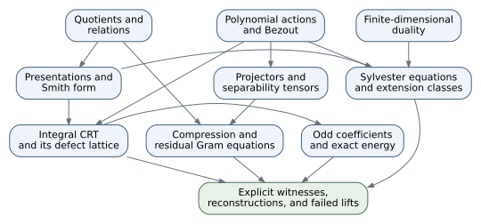

# A reconstructive map: from decompositions to their obstructions

The basic study explains quotients, duality, operators as modules, tensor
universality, exterior algebra, forms, exactness, and representations. The
continuation asks a sharper question: **which extra structure survives a
decomposition, and how can its failure be computed?** Four concrete outputs
organize the new material:

- an invariant complement, or a reverse-intertwiner witness that it cannot exist;
- an equivariant section obtained by a justified averaging operation;
- an integral coefficient vector reconstructed from cyclotomic data, or a
  congruence obstruction;
- a common sign lift of compressed rows, or a residual correlation defect.

These outputs require different hypotheses. A vector-space splitting is not
automatically invariant; a rational splitting is not automatically integral;
an integral vector is not automatically a sign vector; four individually
possible lifts need not satisfy their equations together.

## Dependencies and what each step adds

Begin with quotients and the factorization rule: a map descends precisely when
it kills the relations. This one rule constructs tensor products, module
presentations, quotient operators, and cyclic group-algebra compression.
It tells us how to form the new object, not whether a section exists.

Next add polynomial evaluation and Bézout. Coprime annihilators give
idempotent projectors. In the operator setting, the same identity gives the
inverse of a Sylvester operator. With an invertible derivative it gives a
separability tensor and a universal averaging operation. Over the integers,
the denominators that appear are arithmetic information: they lead to
resultants, finite cokernels, and Smith divisibility.

Add finite-dimensional duality to turn a failed linear equation into a
witness. The trace pairing identifies the annihilator of the Sylvester
image with reverse intertwiners. Add module presentations to compute the
same obstruction as an extension class, and Smith form to determine how
that class changes the middle module. The witness and the module type are
different outputs.

Finally add a coefficient lattice, an involution, and real positivity.
Cyclotomic evaluation preserves multiplication and involution and identifies
the integral coefficient lattice with a finite-index sublattice of the
product of cyclotomic integer rings. Allowing arbitrary tuples in that
larger product forgets the integral compatibility.
Trace reconstruction describes its exact image. Membership in the affine
lattice of odd coefficient vectors, together with the exact total energy,
forces signs. Compression discards a complementary ideal, so it retains
only part of the Gram equation; the explicit core-nine defect lies in the
discarded part.

No step requires importing schemes or differential topology. Homological
language is useful here because its first extension group has an explicit
matrix presentation; the Hadamard calculations themselves do not depend
on a general course in derived functors.

## Eight principles to reconstruct rather than memorize

### 1. Quotients encode relations

**Minimum data.** A module $F$, a submodule of relations $N$, and a module map
$f:F\to Q$ with $N\subseteq\ker f$.

**Construction.** Define $\bar f(x+N)=f(x)$. The kernel condition is
exactly what makes the answer independent of the representative, and
surjectivity of $F\to F/N$ proves uniqueness.

**Families recovered.** Balanced tensor maps, cokernel maps, cyclic-module
presentations, induced quotient operators, and the map
$\mathbb Z[C_m]\to\mathbb Z[C_d]$.

**Failure to detect.** Factorization says nothing about a section. The
quotient $\mathbb Z\to\mathbb Z/2$ has no additive section; an invariant
quotient of a Jordan block need not have an invariant complement.

### 2. Bézout gives projectors and inverses

**Minimum data.** An endomorphism $T$ of a module over a commutative
ring, with $a(T)b(T)=0$ and $ua+vb=1$ in that ring's polynomial algebra.

**Construction.** The operators $v(T)b(T)$ and $u(T)a(T)$ add to the
identity. The first acts as the identity on $\ker a(T)$ and vanishes
on $\ker b(T)$; the second does the reverse. Their images lie in those
respective kernels, and their cross product is zero, so they are
complementary idempotents.

**Families recovered.** Primary decomposition, CRT coordinates, polynomial
spectral projectors, and the divided-difference inverse of
$h\mapsto Ah-hB$ when $a(A)=b(B)=0$.

**Failure to detect.** Coprimality over $\mathbb Q[t]$ does not imply
an integral Bézout identity. The factors $t$ and $t-2$ produce a rational
graph with slope $1/2$ and an integral obstruction of order two.

### 3. A dual kernel certifies a missing image

**Minimum data.** A linear map $D:H\to H'$ of finite-dimensional vector
spaces and perfect pairings with their dual spaces.

**Construction.** $\operatorname{im}D=(\ker D^*)^\perp$. One direction
is evaluation; the converse extends a basis of the image to a basis of the
codomain and constructs a separating linear functional.

**Families recovered.** Solvability certificates, annihilator identities,
and the trace criterion
$C\in\operatorname{im}(Ah-hB)$ exactly when
$\operatorname{tr}(gC)=0$ for every $gA=Bg$.

**Failure to detect.** A field-valued witness cannot see a torsion
cokernel that disappears over that field. Integral divisibility requires
more than rational trace equations.

### 4. A presentation records both a module and how it is attached

**Minimum data.** Relations $fu=0$, $ge=cu$ over a PID $R$, with
$f,g\ne0$ and specified endpoint identifications with $R/(f),R/(g)$.

**Construction.** The relation matrix is
$\left(\begin{smallmatrix}f&-c\\0&g\end{smallmatrix}\right)$.
Changing the chosen lift changes $c$ by $gh$ modulo $f$.
The extension class is $c\bmod(f,g)$; the middle module has Smith
factors $\gcd(f,g,c)$ and $fg/\gcd(f,g,c)$.

**Families recovered.** Cyclic Ext computations, Jordan-block gluing,
integer-lattice quotients, and the difference between classification with
fixed endpoint maps and classification after forgetting them.

**Failure to detect.** Equal middle-module types need not mean equivalent
extensions. The residues $1$ and $1+t$ modulo $t^2$ give distinct
endpoint-preserving classes but the same middle module $k[t]/(t^4)$.

### 5. A separability tensor repairs maps

**Minimum data.** An associative unital algebra $S$ over a field $k$,
with a tensor $E=\sum_i a_i\otimes_k b_i$ satisfying
$\sum_i a_ib_i=1$ and
$\sum_i sa_i\otimes b_i=\sum_i a_i\otimes b_i s$.

**Construction.** For left $S$-modules, send a $k$-linear map $f$ to
$v\mapsto\sum_i a_i f(b_iv)$. The two tensor identities prove
$S$-linearity and show that this operation fixes every $S$-linear map.

**Families recovered.** Maschke averaging and polynomial spectral
averaging. Sections and retractions are repaired when the surrounding
maps are already module maps.

**Failure to detect.** Averaging an arbitrary idempotent map need not
preserve idempotence. Endpoints annihilated by $m$ do not imply that the
middle module of an extension is annihilated by $m$. Over an imperfect
field, a field extension can be semisimple as a ring without being
separable over the ground field.

### 6. An injective rational decomposition can have an integral defect

**Minimum data.** Monic $f,g\in\mathbb Z[t]$ coprime over $\mathbb Q[t]$.

**Construction.** The integral CRT map has cokernel
$\mathbb Z[t]/(f,g)$ as an additive group, of order
$|\operatorname{Res}(f,g)|$. Smith form refines its order into exact
congruences. In a product of cyclotomic factors, trace inversion tests the
whole coefficient lattice.

**Families recovered.** Prime gluing, prime-power overlap jets, the
cyclic integral Fourier lattice, and the resultant formula for the
determinant of a Sylvester operator.

**Failure to detect.** Pairwise congruences among several factors can
miss a congruence against the whole previously glued block. At order
four, the tuple $(0,0,1+i)$ passes every pairwise overlap but reconstructs
half-integer coefficients.

### 7. Parity plus a sharp energy bound forces signs

**Minimum data.** A list $x_1,\ldots,x_N$ of odd integers with
$\sum_jx_j^2=N$.

**Construction.** Each squared coefficient is at least one. Equality
in the sum forces every square to be one.

**Families recovered.** The all-order affine-lattice sign certificate:
under the exact four-row spectral norm equations, membership of each
tuple in $J+2L$ forces every reconstructed coefficient to be a sign.
Here $L$ is the integral Fourier image and
$J=(n,0,\ldots,0)$ is the image of $1+t+\cdots+t^{n-1}$.

**Failure to detect.** Integral coefficients and the correct energy
alone allow zeros and larger entries. At odd order, component parity
can be combined with integral gluing because the CRT defect has no
two-torsion. At even order this simplification fails; one must test the
half-shifted tuple in $L$.

### 8. An idempotent splits equations but not discrete choices

**Minimum data.** A self-adjoint central idempotent $e$ in a real
algebra with involution.

**Construction.** Write $X=eX+(1-e)X$. Cross products vanish, so a
Gram equation splits into its two ideal components. For cyclic compression,
$e$ is averaging over the kernel subgroup.

**Families recovered.** An exact retained-energy calculation, the residual
Gram equation, individual fiber lift counts, and the core-nine defect
$8(S_p-S_k)$.

**Failure to detect.** A split real equation need not admit a solution
in the prescribed finite fiber vertex sets. Exact relaxation is still
relaxation when it forgets part of the domain.

## A shorter route through the books

There are two coherent routes to canonical forms. A reader staying with
undergraduate linear algebra can use Xi's Cayley–Hamilton proof, primary
splitting, quotient-lift Jordan construction, and image–kernel chain
algorithm, assuming the minimal polynomial splits over the working field.
A reader who needs integral presentations and nonsplit
operators can instead establish polynomial torsion by linear dependence
among powers, prove one PID structure theorem, and derive rational
and Jordan forms. Using Jordan as the sole proof of Cayley–Hamilton
while also using Cayley–Hamilton to establish that Jordan route would
be circular.

The source comparisons give precise inspected pages and stopping tests.
They support compressing repeated theorem coverage, not discarding all
alternate proofs. Xi's quotient-lift and filtration constructions teach
different skills; Hungerford's bounded-primary splitting lemma has
additional scope; Grillet's relative-basis proof is particularly useful
for the integral chapters. Xi already proves tensor universality and
two forms of Maschke's theorem. The graduate texts supply broader module
settings, exactness arguments, and different dependencies.

For the present project, learn one proof of each common structural
theorem, then reconstruct the new chapters in this order:

1. Extract $C$ from an invariant-subspace problem, solve
   $Ah-hB=-C$, and give a trace witness for a nonsplit example.
2. Compute the same class through a cyclic presentation and determine its
   middle-module Smith factors. Check a characteristic-two example.
3. Construct the polynomial averaging tensor and the group averaging
   tensor, then explain precisely which sections each repairs.
4. Derive the prime integral CRT image and trace inverse. Find the missing
   congruence in the order-four pairwise counterexample.
5. Prove the affine-lattice sign theorem from odd coefficient energy and
   explain the odd/even distinction.
6. Count normalized symmetric lifts and reproduce the core-nine residual
   polynomial without enumerating Gram matrices by hand.

These are performance tests, not a page quota. Passing them means the
reader can reconstruct a decomposition, name its domain of validity,
and exhibit a concrete obstruction to the tempting stronger assertion.
