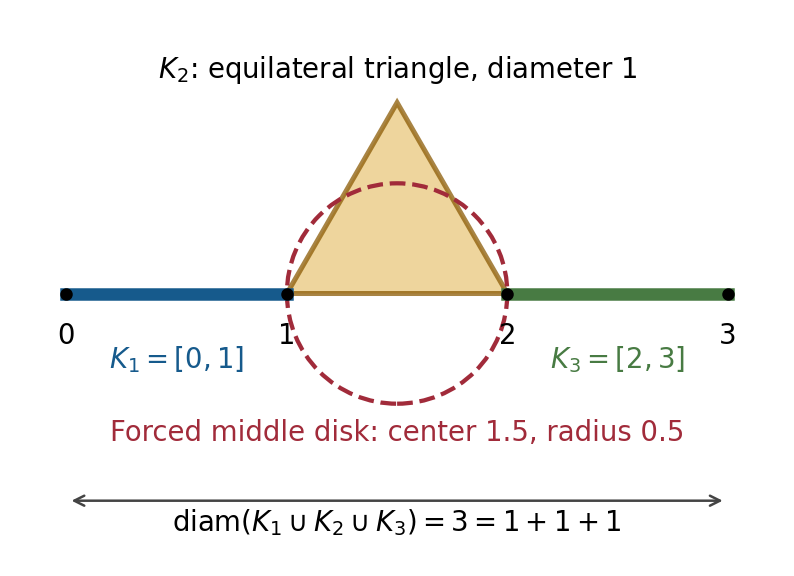

# Overall assessment

**No counterexample to Zhang's main theorem or demonstrated fatal error in its new arguments was found. The expanded audit did find an explicit error in an auxiliary assertion of a cited paper, an important qualification of the Lean formalisation, and unresolved proof-level dependencies.** These findings are different and should not be conflated.

1. Ghys's 1995 Lemma 4.3, Fact 1, p. 596 contains a false disk-containment strengthening. An elementary counterexample and an independently checked repair of its needed weaker consequence are given below. This does not refute Ghys's classification theorem or Zhang's result.
2. The Lean statements of Theorem A, Theorem 1.1, and Theorem 1.3 explicitly assume an unproved `HomotopyTorusRigidity` proposition. Theorem 1.2 does not. The README discloses this. The actual formal statements are therefore conditional on that classical topological input.
3. The inspected Lean definitions otherwise faithfully express the manuscript's geometry and conclusions. No hidden transitivity hypothesis, vacuous geometric input, replacement of complex rank one by real rank one, or weakened conjugacy conclusion was found. This is a bounded source audit, not a reproduced kernel verification.
4. A particular inference in Ghys's original Schwarzian/Markov proof remains unclosed by this audit. It remains on Zhang's cited complex-surface base-case path. The original Manning 1974 recurrence proof also remains inaccessible and independently unverified here.
5. The initial review's closed-disk clarification for Zhang Lemma 2.10 remains appropriate. Its global conclusion can independently be reconstructed from the flat connection and complete stable coordinates, without transitivity.

The initial limited review is preserved in separately labelled files. This report supersedes its citation and formalisation coverage statements. Confidence is high in the explicit counterexample, its repair, the inspected statement correspondence, and the displayed local estimates; confidence is necessarily more limited for a claim of end-to-end verification through every cited proof. Such a claim is **not** made.

# Sources and reproducibility boundary

The mathematical source is the exact 19-page, 371,989-byte attachment showing **arXiv:2609.37695v3, 13 October 2026**, by Jiesong Zhang. Its unchanged SHA-256 is:

```text
3c8287bf41d153c7f0d0950b8a4b477546229333ee66ba7e9ae60e6a387920c6
```

The formal source is [frenzymath/HolomorphicAnosov](https://github.com/frenzymath/HolomorphicAnosov/tree/65f2b33a7309de661a8500e4642e5609a537a8ff), pinned to:

```text
65f2b33a7309de661a8500e4642e5609a537a8ff
```

This commit is dated 13 October 2026. The checked `lean-toolchain` requires **Lean 4.35.0-rc1**. The lockfile pins Mathlib to **c32e1ec0d1eb5237ba344eee50162f45d5b0fc76**, and the remote Mathlib tag was checked to resolve to that commit. Every other dependency revision is recorded in `evidence/formalisation-manifest.json`.

Only an existing Lean 4.24.0 distribution was available. Lean 4.35.0-rc1 and the matching Mathlib build/cache were not installed. No new tools were installed, no repository setup scripts or Lean code were executed, and no build, comparator run, or `#print axioms` check was reproduced. The official compiler and locked dependencies would be required for that further check. Even a successful build would not by itself establish correspondence with the manuscript.

The repository's README claims successful checking and a standard-axiom-only result. Those claims were read as assertions, not treated as independent verification. A read-only GitHub Actions query returned zero visible workflow runs at the time of this audit; this does not disprove that checking was performed elsewhere.

# Claim and dependency map

| Claim | Main dependencies | Current assessment |
|---|---|---|
| Theorem 1.1 for $d\ge3$, pp. 5–12 | Ghys Proposition 2.2; invariant flat quotient connection; complete stable coordinates; global holonomy; developing/deck reduction; homotopy-torus recognition; Franks–Manning | New analytic and global arguments reconstructed; last classical classification has the explicit source-proof limits below |
| Surface base cases of Theorems 1.1 and 1.3 | Ghys Theorem A, including Proposition 4.1 | Cited result's statement and dependency path checked; special measure-to-transitivity inference remains audit-unresolved |
| Theorem 1.3 for $d\ge3$, pp. 15–17 | Theorem 1.1; complete coordinates; descended eigenform; Jacobian and $L^2$ estimates; distributional Cauchy–Riemann regularity | Internal estimates and holomorphicity upgrade reconstructed; inherits Theorem 1.1's external dependencies |
| Theorem 1.2, pp. 12–14 | Franks–Manning; lattice projection density; holomorphic global product; limits of translated biholomorphisms; smooth translation action | Internal argument reconstructed, including a direct action-smoothing substitute; inherits classical conjugacy input |
| Theorem A, p. 2 | Reverse $f$ if necessary; apply 1.1, 1.3 and 1.2; recover hyperbolicity | Follows subject to those inputs and the opening connected-manifold convention |
| Final example, pp. 17–18 | Two-step real group, arithmetic lattice, unit automorphism, invariant frame and antiholomorphic derivatives | Direct algebraic and dynamical checks; stable and unstable complex ranks are three, so it does not contradict codimension one |

Foundational inputs and the precise scope of their proof audits are listed separately below. The Lean chain is a distinct proof implementation and is compared with these statements later in this report.

# Findings in Zhang's mathematical proof

## Global holonomy, Lemma 2.10, pp. 11–12

The notation $D_R=\phi_x^{-1}(B(0,R))$ is followed by compactness assertions. With the usual open-ball convention, $D_R$ is not compact. Use

$$K_R=\phi_x^{-1}\{v\in E_x^s:\|v\|\le R\},$$

and define holonomy on a neighborhood of this closed disk. A slightly larger disk handles boundary neighborhoods. If the author's ball convention already means closed balls, this is a clarification rather than a literal error.

The substantive continuation issue was challenged independently. Define $L_t$ using the always available local holonomy germ along a small unstable base path $\gamma$, and put

$$H_t=\phi_{\gamma(t)}^{-1}L_t\phi_x.$$

Lemma 2.7 supplies joint continuity of the entire inverse coordinates. Thus $H_t$ is continuous on compact parameter-disk products. Before any maximal continuation time it agrees with actual holonomy by the identity theorem. Near a limiting point the actual lifted path's final interval stays in one foliation box. Its transverse coordinate is locally constant on that interval, hence constant up to its limit. Finite product-box tubes over closed stable disks supply both the positive initial time and uniform endpoint continuation. This uses the entire continuous path, not the invalid assertion that an arbitrary convergent sequence in an immersed leaf has its limit in that leaf.

There is a stronger independent reconstruction. On the simply connected cover, trivialize the flat normal connection. The quotient form becomes a closed scalar holomorphic form $dq$, where $q:\widetilde X\to\mathbb C$. Put $\ell_x=dq_x|_{E_x^s}$. The local coordinate relation extends along the stable curve to

$$q(p)=q(x)+\ell_x\phi_x(p).$$

Completeness of $\phi_x$ makes this a bijective coordinate on every stable leaf. With $F_0=q^{-1}(0)$, the maps

$$x\mapsto\bigl(\phi_x^{-1}(-\ell_x^{-1}q(x)),q(x)\bigr),
\qquad
(r,z)\mapsto\phi_r^{-1}(\ell_r^{-1}z)$$

are continuous inverses between $\widetilde X$ and $F_0\times\mathbb C$. Connectedness makes every fiber a single unstable leaf. Matching $q$ values therefore produces actual entire unstable holonomy. This establishes the global product conclusion without assuming it.

This check supports the removal of transitivity in the new $d\ge3$ argument. It does not settle every classical theorem used after that argument. The initial review contains the full reconstruction of the connection, Jacobian, stable-coordinate, eigenform, and $L^2$ estimates; those calculations remain unchanged.

## Other conclusions retained from the initial review

The curvature estimate in Lemma 2.3 correctly uses

$$J_\nu(f^n)=\|Q_n\|^2|\det_{\mathbb C}U_n|^2,
\qquad
|\det_{\mathbb C}U_n|\ge\|U_n\|m(U_n)^{d-2},$$

so its integrated decay works for $d\ge3$ without an invariant volume. Section 4 correctly descends a holomorphic eigenform and uses the analogous Jacobian bound to make the antiholomorphic derivatives of the smooth approximations tend to zero in $L^2$. Section 3's lattice density, holomorphic product, inverse-limit, and action-smoothing arguments reconstruct correctly once its topological conjugacy input is available. The final real nilpotent group, arithmetic lattice, holomorphic automorphism, and nonholomorphic invariant bundles were directly checked. None supplied a counterexample to the stated codimension-one theorem.

# Confirmed error in a cited auxiliary assertion

## Ghys 1995, Lemma 4.3, Fact 1, p. 596

Ghys asserts that when a connected compact plane set is the union of finitely many nonempty compact sets and its diameter equals the sum of their diameters, containing closed disks can be chosen with pairwise disjoint interiors and collinear centers. That geometric strengthening is false.

Take

$$K_1=[0,1],\qquad K_3=[2,3],\qquad
K_2=\operatorname{conv}\{1,2,\tfrac32+i\tfrac{\sqrt3}{2}\}.$$

Each set has diameter one. Their union is connected and has diameter three, realized by the points zero and three. All hypotheses of the printed assertion hold.

Suppose containing disks $D_j$ have disjoint interiors and collinear centers. Since $D_1,D_2$ both contain one, they must be externally tangent there. Similarly $D_2,D_3$ must be externally tangent at two. Their common center line therefore contains both one and two and is the real axis. The middle disk has both points on its boundary, so its center is $3/2$ and its radius is $1/2$. It excludes the triangle apex, whose squared distance from that center is $3/4>1/4$. Contradiction.

{width=90%}

The counterexample was checked independently, including every compactness, connectedness, and diameter condition. Exact symbolic squared distances and a separate adversarial proof are included in the evidence. It is a counterexample to the auxiliary disk conclusion, **not** to Ghys's theorem.

## Repair of the consequence actually needed

The needed statement is that, if all component diameters are positive, no point belongs to three distinct component sets. It is true, in any metric space.

The finite intersection graph is connected: otherwise two disjoint compact unions separate the total set. Choose points realizing its diameter $D$, choose component sets containing them, and join those sets by a simple graph path. Picking points in successive intersections gives

$$D\le\sum_{j\text{ on the path}}\operatorname{diam}K_j
\le\sum_j\operatorname{diam}K_j=D.$$

Every component has positive diameter, so the path must include every vertex. Any edge between nonconsecutive vertices would give a shorter path omitting positive diameter, contradicting the same equality. The graph itself is a path. A triple intersection would yield a triangle in that graph, which is impossible. This replaces the false disk assertion in the subsequent dimension argument.

The independent proof and the original's precise use are recorded in `notes/ghys-fact1-adversarial-check.md` and `evidence/ghys-fact1-counterexample-and-repair.md`. No relevant published erratum was found in the recorded bounded searches; this is not proof that none exists.

# Critical citation proof audit

Checking a theorem's printed statement is distinguished here from reading its proof, reconstructing the implication used, and rechecking its foundational inputs. The complete machine-readable ledger accompanies this report.

| Dependency | Statement/proof coverage | Remaining boundary |
|---|---|---|
| Ghys Proposition 2.2, pp. 589–590 | Original proof read; asymptotically conformal holonomy reconstructed; arbitrary holomorphic transversals and Hartogs graphs supply ambient holomorphicity | Stable-manifold/inclination machinery, quasiconformal compactness and Hartogs remain foundational inputs |
| Ghys Proposition 3.1, pp. 590–593 | Jet-splitting contraction, local holomorphic limits and completeness reconstructed | General jet/ODE and fixed-point foundations not recursively audited |
| Ghys Proposition 4.1 and Lemma 4.3, pp. 593–597 | Schwarzian cocycle, diameter density, invariance and repaired combinatorial consequence checked | Specific acim-to-transitivity inference remains audit-unresolved |
| Ghys Theorem A, pp. 598–600 | Dependency path and projective-developing mechanism read | Uses Proposition 4.1 twice; retains the preceding unresolved source-proof check |
| Ghys after Lemma 5.1, p. 598 | Developing/product/deck reduction reconstructed without transitivity after completeness | Final homotopy-torus recognition and Franks–Manning remain separate dependencies |
| Franks 1969, pp. 117–124 | Original scan read; conditional fixed-point, semiconjugacy and global-product mechanisms reconstructed | The original assumes both full nonwandering set and homological hyperbolicity |
| Manning 1974; Franks 1970 | Required result's scope corroborated by later primary research; parts reconstructed independently | Original proofs not obtained; regional recurrence step not independently completed |
| Hsiang–Wall 1969, pp. 341–342 | Original proof read, final page visually checked; smooth/PL/topological and marked-structure implications examined | Surgery/PL classification, compatibility of invariants, Whitehead-group and Kirby–Siebenmann inputs not reproved |
| HPS 1977, especially §§3,5,7 | Original statements and graph-transform/leaf-derivative mechanisms inspected; specialized local/global leaf consequences reconstructed | Full general section/Lipschitz-jet theorem not reproved line by line |
| Demailly I.(3.29)(a) | Exact edition checked; distributional Cauchy–Riemann implication independently reconstructed | Standard convolution, local holomorphic limits and complex-analytic foundations |
| Bochner–Montgomery 1946 | Original remains inaccessible; the actual free vector-action application has a direct convolution-coordinate proof | Broad general theorem's original proof not checked; unnecessary for this narrower application |

## Unresolved source inference and its exact impact

At the beginning of Ghys Lemma 4.3, a nonzero absolutely continuous invariant measure for the expanding Markov quotient is used to infer transitivity and then positivity of the diameter density everywhere. The generic implication is false: a disjoint union of two expanding systems can preserve an absolutely continuous measure without being transitive. This does not refute the particular implication in Ghys; extra foliation, analytic, or Markov structure may justify it. This audit did not finish that specific justification.

The dependency distinction matters. Zhang's new $d\ge3$ flat affine connection permits the direct developing-map construction above, bypassing Ghys Proposition 4.1. Zhang's $d=2$ base case cites Ghys Theorem A, whose proof uses that proposition. Therefore this source-proof limit remains on the whole-theorem dependency map. It is **not** labelled a demonstrated gap in Zhang's theorem or a counterexample to Ghys's theorem.

## Franks–Manning: what was independently recovered

The original Franks 1969 theorem has hypotheses that the later classification removes. Its root-of-unity exclusion alone does not exclude non-root eigenvalues on the unit circle. In the holomorphic setting, positive local Lefschetz indices give

$$N_m=\#\operatorname{Fix}(f^m)=|\det(I-A^m)|.$$

Finite Markov coding gives exponential upper and lower bounds on $N_{qn}$ for a common period $q$. Factoring off the eigenvalues away from the unit circle and using simultaneous recurrence of the remaining unit-circle powers yields a contradiction to the lower bound unless there are no unit-circle eigenvalues. The counting argument is detailed in the classification note; the Markov coding theorem itself remains an external input.

Once $A$ is hyperbolic, a bounded periodic correction of a lifted map solves the semiconjugacy equation by uniformly convergent stable/unstable series. Properness and index arguments work on the original smooth manifold and do not require a standard torus smooth structure. Franks's subsequent injectivity argument still needs the required recurrence/density input. Manning's 1972 thesis explicitly leaves relevant questions open and cannot substitute for his inaccessible 1974 proof. His 1977 survey's statement that a semiconjugacy maps the nonwandering set onto the target likewise does not establish that the source nonwandering set is the whole manifold.

Accordingly, the full classification is marked **partially checked**, with recurrence explicitly **unverified in this audit**. No failure of the established theorem is inferred.

# Manuscript-to-Lean correspondence

The statements were read in `Comparator/Solution.lean` and the actual `Targets` files, together with the underlying definitions. A separate reviewer challenged the semantics and vacuity checks. The detailed correspondence files provide exact source lines and additional definition rows.

| Manuscript | Actual target at the pinned commit | Assessment |
|---|---|---|
| Theorem A, p. 2 | `Targets/TheoremA.lean:27–35`; solution wrapper `:23–31` | Correct stable-or-unstable complex rank-one alternative and full hyperbolic biholomorphic torus conclusion; **extra explicit HS premise** |
| Theorem 1.1, p. 2 | `Targets/Theorem11.lean:1725–1731`; wrapper `:36–43` | Correct real torus dimension $2d$, actual homeomorphism, hyperbolic integral automorphism and conjugacy; **extra explicit HS premise** |
| Theorem 1.2, p. 3 | `Targets/Theorem12.lean:74–92`; wrapper `:48–67` | Faithful torus-homeomorphism and holomorphic-bundle hypotheses, genuine biholomorphic linear model; **no HS premise** |
| Theorem 1.3, p. 3 | `Targets/Theorem13.lean:462–475`; wrapper `:72–86` | Holomorphic subbundles' realifications equal the original stable/unstable distributions; correct ranks; **extra explicit HS premise** |

All target paths are under `HolomorphicAnosov/`. Pinned source links: [Theorem A](https://github.com/frenzymath/HolomorphicAnosov/blob/65f2b33a7309de661a8500e4642e5609a537a8ff/HolomorphicAnosov/Targets/TheoremA.lean#L27), [1.1](https://github.com/frenzymath/HolomorphicAnosov/blob/65f2b33a7309de661a8500e4642e5609a537a8ff/HolomorphicAnosov/Targets/Theorem11.lean#L1725), [1.2](https://github.com/frenzymath/HolomorphicAnosov/blob/65f2b33a7309de661a8500e4642e5609a537a8ff/HolomorphicAnosov/Targets/Theorem12.lean#L74), [1.3](https://github.com/frenzymath/HolomorphicAnosov/blob/65f2b33a7309de661a8500e4642e5609a537a8ff/HolomorphicAnosov/Targets/Theorem13.lean#L462), [solution wrappers](https://github.com/frenzymath/HolomorphicAnosov/blob/65f2b33a7309de661a8500e4642e5609a537a8ff/Comparator/Solution.lean#L23), and [HS definition](https://github.com/frenzymath/HolomorphicAnosov/blob/65f2b33a7309de661a8500e4642e5609a537a8ff/HolomorphicAnosov/Topology/HomotopyTorusRigidity.lean#L33).

## What the definitions mean

The domain is an actual compact connected Hausdorff second-countable complex manifold with the full $\mathbb C^d$ chart model. `Biholomorph` is a complex-model `Diffeomorph`, with both directions complex smooth. `AnosovDatum` contains a positive-definite smooth Riemannian metric, continuous complementary invariant tangent subbundles, a common iterate $k\ge1$, and the actual restricted derivative contraction inequalities. Its definition does not contain the desired torus, holonomy or holomorphic-bundle conclusions.

Complex rank one is complex finrank one with canonical realification equal to the selected real tangent distribution; it is real rank two. Holomorphic subbundles are defined by genuine local holomorphic tangent frames. The target torus is the actual additive quotient of $\mathbb C^d$ by a discrete full lattice with its quotient complex atlas. Its automorphism is induced by a lattice-preserving complex-linear equivalence. `Semiconj` does not weaken the conclusion, because its conjugating map is an actual biholomorphism and is therefore invertible.

Selected locked Mathlib definitions for lattice fullness, metric positivity and homotopy equivalence were read at the pinned dependency commit. Empty-domain, dimension-zero, dimension-one, changed-topology, zero-seminorm and arbitrary-derivative escape routes were tested. A standard Gaussian-lattice toral automorphism supplies a mathematical nonvacuity example; that example was not separately elaborated in Lean.

## The unproved HS input

`Topology/HomotopyTorusRigidity.lean:33–41` defines a proposition schema: for every $n\ge5$, a closed smooth real $n$-manifold genuinely homotopy equivalent to the standard $n$-torus is homeomorphic to it. It contains no Anosov, complex, holomorphic or conjugacy predicate. It is a general classical topological theorem, not the dynamical conclusion renamed.

Theorem A, 1.1 and 1.3 explicitly quantify over a proof of this proposition. It is applied only after the source supplies a genuine homotopy equivalence on the same selected topology and original smooth manifold. Zhang's high-dimensional use has real dimension $2d\ge6$. The surface branch does not need this topological schema.

This proposition has no proof in the inspected interface. A source search and the inspected target chain found no discharge supplying an unconditional final corollary. Its status as a hypothesis rather than an `axiom` declaration explains how a compiled conditional result could have only standard logical axioms while still leaving a substantive classical theorem unformalised. The manuscript's broad formalisation sentence on pp. 4–5 should state this qualification.

## Global-holonomy and cited-result proof bridges

The internal global-holonomy interface records whole-leaf biholomorphic extensions compatible with actual local holonomy germs and coherence laws. It does not separately require every arbitrary point's image to remain on the original complementary leaf. This difference alone is not a final-theorem defect: the downstream identity theorem compares projective developing maps on entire leaves, so their ranges and omitted poles coincide; a common-pole argument then supplies affine development and global product structure. The argument was reconstructed at this level.

The inspected source supplies proof bodies for the connection, curvature, complete-coordinate, distributional regularity, Ghys, Franks–Manning, and action-smoothing bridges. They are not additional certificates in the final theorem signatures. Some comments still mention admissions or gaps, but the corresponding inspected declarations now contain substantive proofs. Comments alone were not counted as admissions.

The formal source's Ghys Proposition 4.1 uses an alternate finite integral-budget and disjoint-path packing argument. It does not use the false containing-disks strengthening or the original acim-to-transitivity inference. Immediate records and providers were inspected for hidden transitivity/full-support assumptions; none was found there. This neither verifies every lower proof nor validates the unclosed inference in the original Ghys text. The formal source's higher-dimensional classification path does use its projective-developing bridge, even though the direct affine reconstruction of the paper can bypass it.

# Placeholders, dependencies, execution and evidence

The supplied reproducible scanner erases nested comments and strings, then scans noteworthy tokens and computes local module import reachability. Its result at the pinned commit is:

| Item | Static result |
|---|---|
| Lean files / source lines | 4,232 / 527,770 |
| Solution local import closure | 4,230 modules |
| Theorem A local import closure | 4,229 modules |
| Theorem 1.1 / 1.2 / 1.3 closures | 4,033 / 2,162 / 4,138 modules |
| Active `sorry` tokens | Four, all in the challenge specification |
| Challenge imported by the solution | No |
| Scanned noteworthy tokens in solution local import closure | None |

The four challenge theorem bodies are expected specification placeholders. The solution separately imports and applies the actual target proofs. The challenge's `run_cmd` clears an auxiliary-lemma cache; it is outside the solution import closure. The comparator configuration lists the four target names and permits `propext`, `Quot.sound`, and `Classical.choice`.

**These are lexical and source-graph results.** They do not establish successful elaboration, declaration-level transitive proof dependencies, compiled axiom dependencies, comparator acceptance, integrity of prebuilt artifacts, or the correctness of every imported Mathlib theorem. All manifest dependency revisions are pinned, but their code and build products were not exhaustively audited. No claim of formal verification by this review is made.

The evidence bundle includes the scanner and complete results, repository/configuration hashes, dependency pins, proof/citation ledgers, bounded search/access logs, the exact auxiliary counterexample and repair, independent challenge notes, and PDF rendering checks. It excludes the supplied paper, cited-source PDFs, scans, source OCR transcriptions, private file/task identifiers, and credentials.

# Remaining limits and recommended disposition

The new mathematical argument in complex dimension at least three remains supported by the independent reconstruction, including global holonomy. The final example remains consistent. The expanded review does not establish that every cited proof or every formal proof has been fully verified.

All 19 manuscript pages were read. The three proof sections, introduction's hypotheses and quantifiers, final example, and bibliography were covered. Historical/contextual results of Smale, Newhouse, Catanese and Catanese–Oguiso–Peternell, Xu–Zhang, and the separate Zhang preprint were not independently proof-audited; they are not needed in the reconstructed new proof. The initial notes document their role and the distinction from critical dependencies. Errata searches were bounded and sometimes noisy; a negative search is not evidence that no correction exists.

The most material remaining items are:

- obtain and inspect the original Manning 1974 recurrence proof, and the inaccessible Franks 1970 treatment, or complete an independent substitute for the required recurrence/injectivity step;
- close the specific source-level inference in Ghys Lemma 4.3 on the surface-case path, without mistaking a generic acim assertion for the special statement needed;
- install the exact official toolchain and locked dependencies only with the required authorization, then reproduce the build/comparator and compiled axiom audit;
- retain the semantic comparison even after such a build, and discharge or explicitly carry the homotopy-torus rigidity premise;
- retain the mapped foundational boundaries in HPS, Markov coding, quasiconformal compactness, complex analysis and surgery theory.

The justified verdict is **supportive but incomplete verification**, with one repaired cited-source overstatement and one explicit formalisation qualification. Neither the cited error nor the undischarged Lean premise supplies a counterexample to Zhang's theorem. The remaining unchecked steps should remain visible rather than being converted into assertions of correctness or allegations of falsehood.
